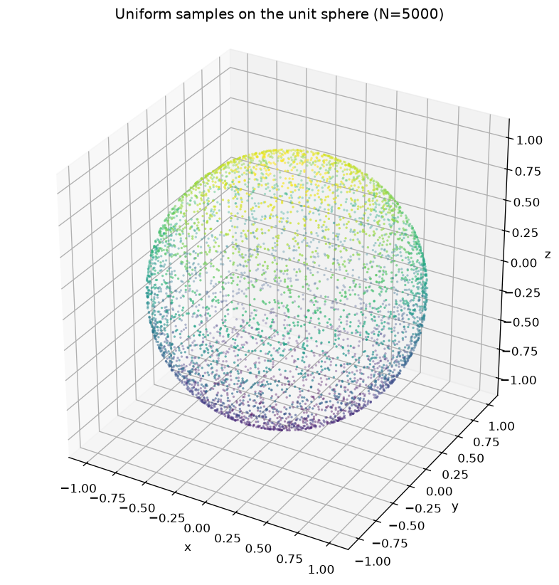

# Uniform Point Sampling on a Sphere

A small scientific-computing use case: generate a **uniform random distribution
of points on the surface of a sphere** of arbitrary radius \(R\), then visualize
the resulting point cloud.

This repository modernizes an early coursework prototype into a portfolio-ready
example with a clear C library boundary, a thin CLI, a Python plotting step, and
documented methodology.

<p align="center">
  
</p>

## Why this matters

Uniform sphere sampling shows up in Monte Carlo integration, directional
statistics, molecular / condensed-matter models, and graphics (environment
maps, particle systems). Getting the measure right matters: sampling polar
angle \(\theta\) uniformly produces clustering at the poles; sampling
\(u = \cos\theta\) uniformly does not.

## Method (short)

Draw independent uniforms

$$
u \sim \mathcal{U}[-1,1], \qquad \phi \sim \mathcal{U}[0, 2\pi]
$$

and map them to Cartesian coordinates on the sphere of radius \(R\):

$$
\begin{aligned}
x &= R\sqrt{1-u^{2}}\,\cos\phi,\\
y &= R\sqrt{1-u^{2}}\,\sin\phi,\\
z &= R\,u.
\end{aligned}
$$

Full derivation: [docs/methodology.md](docs/methodology.md).  
Layout and layering: [docs/architecture.md](docs/architecture.md).

## Project layout

```
include/sphere_sampler.h   Public C API (PointCloud)
src/c/                     Sampler library + CLI
src/python/plot_sphere.py  3D visualization
examples/                  Sample .dat + figure
docs/                      Methodology and architecture
```

## Requirements

- C compiler with C11 support (`cc` / `gcc` / `clang`)
- `make`
- Python 3.10+
- `numpy`, `matplotlib` (see `requirements.txt`)

```bash
python3 -m venv .venv
source .venv/bin/activate
pip install -r requirements.txt
```

## Quick start

```bash
make run                 # build, sample N=5000 on unit sphere, plot
# or with overrides:
make run N=8000 R=2.5 SEED=7
```

Outputs land in `results/` (`points.dat`, `sphere.png`).  
Refresh the committed demo under `examples/` with `make example`.

### CLI

```bash
make
./bin/sphere_sampler --help
./bin/sphere_sampler -n 5000 -r 1.0 -s 42 -o results/points.dat
python3 src/python/plot_sphere.py -i results/points.dat -o results/sphere.png
```

## Design choices

- **Library vs. driver**: sampling lives in `sphere_sampler.c`; `main.c` only
  handles arguments and exit codes.
- **Reproducibility**: optional RNG seed (`-s`) for deterministic clouds.
- **Loose coupling**: whitespace \(x\,y\,z\) files are the handoff between C
  and Python—no shared runtime.
- **Explicit artifacts**: generated results are gitignored; `examples/` keeps
  a stable visual for the README.

## License

MIT — see [LICENSE](LICENSE).
