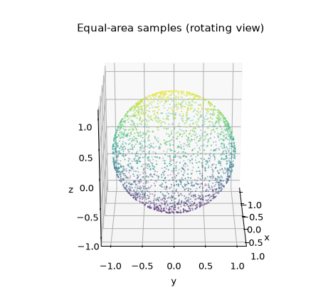
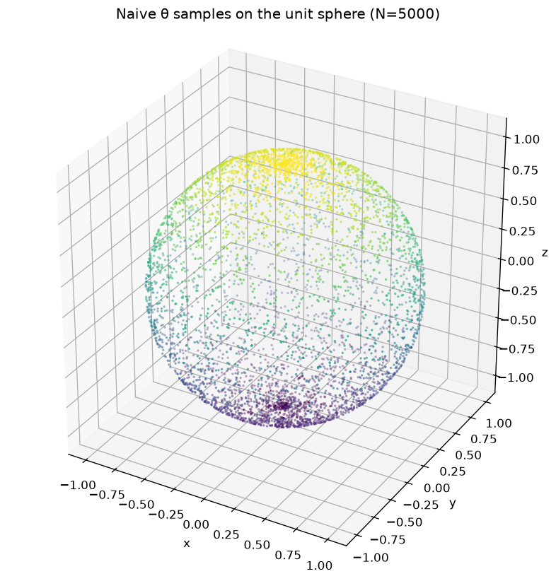
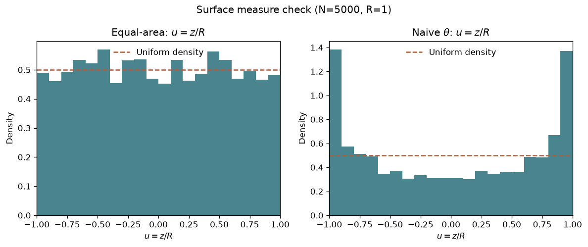

# Uniform Point Sampling on a Sphere

[](https://github.com/juandapradam12/SphereSurfaceSampler/actions/workflows/ci.yml)

A scientific-computing use case: draw points on a sphere of radius $R$ that
are **uniform with respect to surface area**, show what goes wrong with a
naive angular draw, and back the claim with a simple statistical check.

## The problem

Applications in Monte Carlo integration, directional statistics, and graphics
often need samples from the Haar measure on

$$
S_R = \left\lbrace (x,y,z) : x^2 + y^2 + z^2 = R^2 \right\rbrace.
$$

Drawing the polar angle $\theta$ uniformly on $[0,\pi]$ looks natural, but
it is wrong: ring area scales with $\sin\theta$, so mass piles up at the
poles.

The equal-area construction samples $u = \cos\theta$ instead:

$$
u \sim \mathcal{U}[-1,1], \qquad \phi \sim \mathcal{U}[0, 2\pi],
$$

$$
\begin{aligned}
x &= R\sqrt{1-u^{2}}\,\cos\phi,\\
y &= R\sqrt{1-u^{2}}\,\sin\phi,\\
z &= R\,u.
\end{aligned}
$$

Full derivation: [docs/methodology.md](docs/methodology.md).

## What equal-area sampling looks like

With $N = 5000$ points on the unit sphere, the cloud covers the surface
without a visible polar excess from every angle. Color encodes $z$.

<p align="center">
  
</p>

## What goes wrong with naive $\theta$

The same seed and budget, but $\theta \sim \mathcal{U}[0,\pi]$. Points still
lie on the sphere, yet density concentrates near $z = \pm R$.

<p align="center">
  
</p>

## Evidence in one coordinate

Both clouds satisfy $\lVert p_i \rVert \approx R$. The diagnostic that separates
them is the marginal of $u = z/R$:

- equal-area should match density $1/2$ on $[-1,1]$
- naive $\theta$ follows $f_u(u) = 1/(\pi\sqrt{1-u^2})$ (U-shaped)

<p align="center">
  
</p>

On this run ($N=5000$, $R=1$, seed $42$):

| Method | $\chi^2/\mathrm{dof}$ for $u$ vs $\mathcal{U}[-1,1]$ | On-sphere max $\lvert \lVert p \rVert - R \rvert$ |
|--------|------------------------------------------------------|-----------------------------------------------------|
| Equal-area | $\approx 1.38$ | $\sim 10^{-10}$ |
| Naive $\theta$ | $\approx 100$ | $\sim 10^{-10}$ |

Same geometry, different measure — the histogram and $\chi^2$ catch what a
quick glance at a 3D scatter can miss.

## Run it

```bash
python3 -m venv .venv && source .venv/bin/activate
pip install -r requirements.txt

make run                 # sample both methods + plot + validate
make gif                 # rotating GIF of equal-area samples
make test                # smoke checks (also run by CI)
make example             # refresh committed figures under examples/
```

```bash
./bin/sphere_sampler -n 5000 -r 1.0 -s 42 -m equal-area -o results/points.dat
./bin/sphere_sampler -n 5000 -r 1.0 -s 42 -m naive      -o results/points_naive.dat
python3 src/python/plot_sphere.py -i results/points.dat -o results/sphere.png
python3 src/python/validate_uniformity.py \
  --equal-area results/points.dat \
  --naive results/points_naive.dat \
  --radius 1.0
```

Requires a C11 compiler, `make`, and Python 3.10+ (`numpy`, `matplotlib`).

## Layout

```
include/sphere_sampler.h          Public C API (PointCloud)
src/c/                            Sampler library + CLI
src/python/plot_sphere.py         3D visualization
src/python/animate_sphere.py      Rotating GIF for the README
src/python/validate_uniformity.py Radius + u=z/R checks
examples/                         Story figures + sample data
docs/                             Methodology and architecture
.github/workflows/ci.yml          Build + smoke test
```

Design notes: [docs/architecture.md](docs/architecture.md).

- Library vs. CLI stay separate; `--method equal-area|naive` shares one API.
- Seeded portable RNG keeps clouds reproducible.
- Whitespace $x\,y\,z$ files couple C and Python without a shared runtime.
